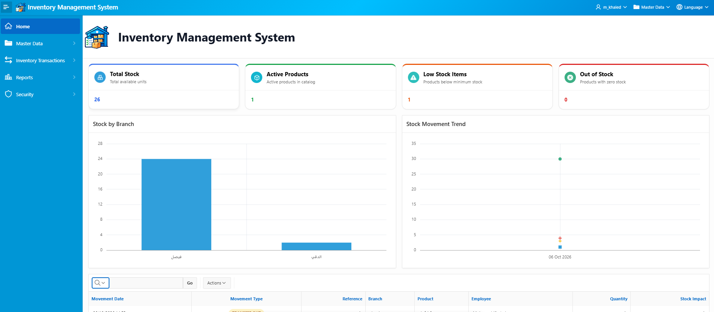
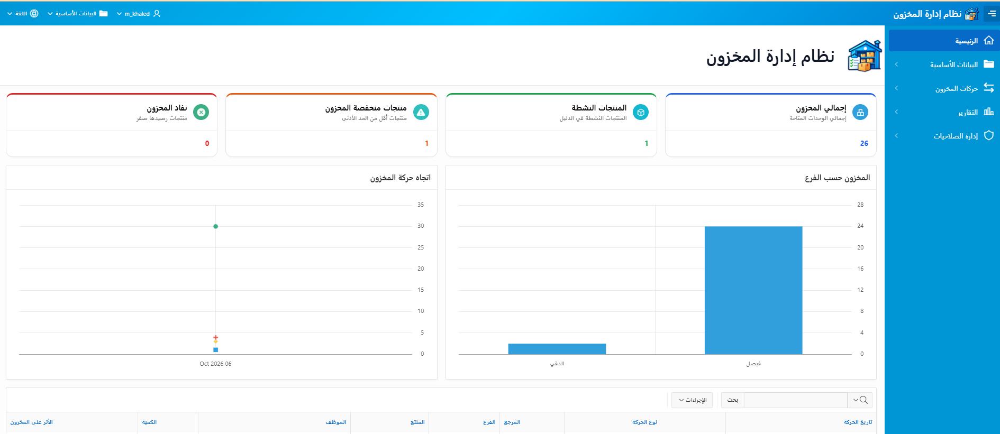
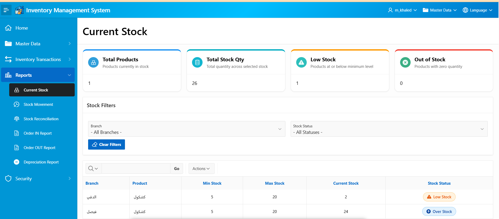
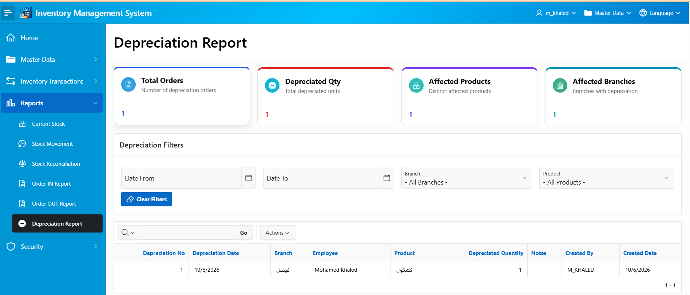
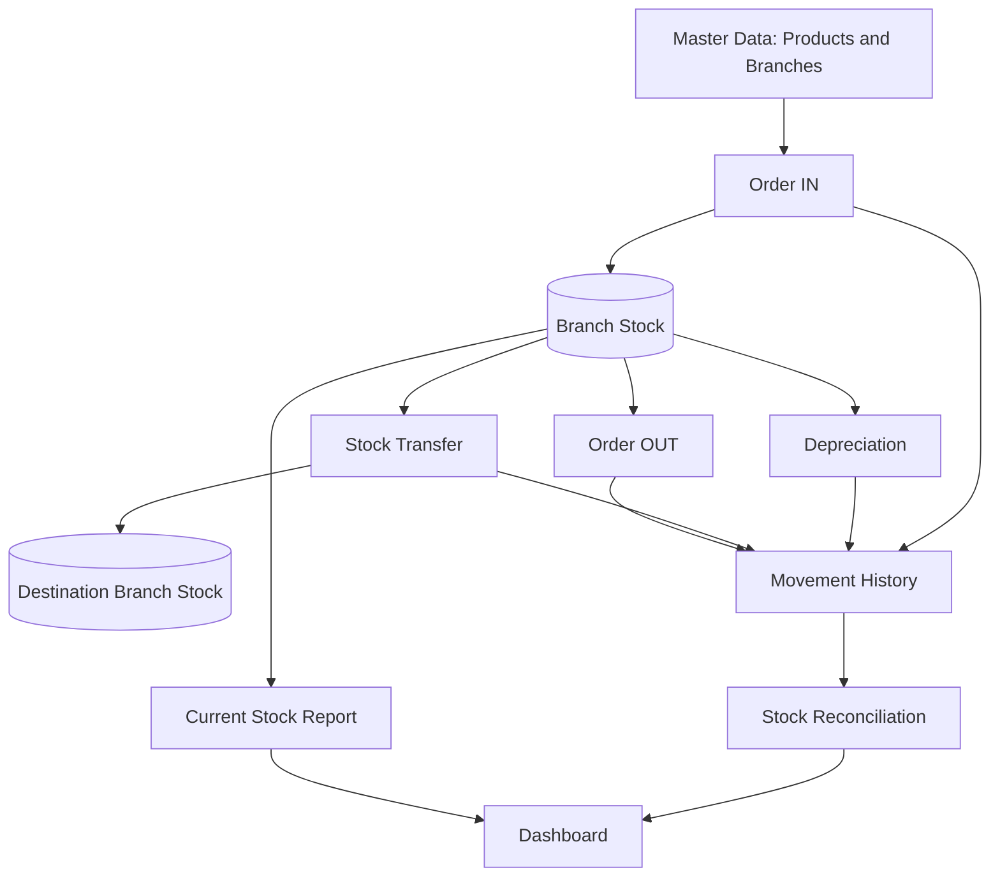

<div align="center">


# Inventory Management System
### نظام إدارة المخزون

**An Oracle APEX inventory solution for multi-branch stock control, transactions, reporting, and role-based access.**

**نظام لإدارة المخزون بين الفروع، وتسجيل الحركات، وإعداد التقارير، والتحكم في الصلاحيات.**


</div>

---

## Overview

**Inventory Management System** is a bilingual Oracle APEX application for recording incoming and outgoing inventory, transfers between branches, and depreciation. It provides stock monitoring, operational reports, reconciliation, and authorization-based navigation.

## Application Preview

### Dashboard — English

<p align="center"></p>

### Dashboard — Arabic / RTL

<p align="center"></p>

### Inventory Reports

<p align="center"></p>

### Depreciation Order

<p align="center"></p>

> Screenshots show example local-development data and may differ from the latest deployed version.

---

## Business Workflow



## Main Features

| Module | Capabilities |
|---|---|
| **Dashboard** | Total stock, active products, low-stock and out-of-stock indicators, stock charts |
| **Master Data** | Branches, products, categories, units, suppliers, customers, employees |
| **Order IN** | Record receiving orders and increase branch stock |
| **Order OUT** | Record issues and deduct available quantities |
| **Stock Transfer** | Move quantities between source and destination branches |
| **Depreciation** | Record depreciated quantities and deduct branch stock |
| **Current Stock** | Review stock levels, minimums, and stock status |
| **Stock Movement** | View inventory transactions with filtering |
| **Stock Reconciliation** | Compare current stock with calculated movement totals |
| **Operational Reports** | Order IN, Order OUT, and depreciation reports |
| **Security** | Role-based access and authorization schemes |
| **Localization** | Arabic RTL and English LTR interface |

## Inventory Rules

- **Receiving:** adds quantity to the selected branch.
- **Issuing:** subtracts quantity; insufficient stock is rejected.
- **Transfer:** subtracts from the source branch and adds to the destination branch.
- **Depreciation:** subtracts the depreciated quantity.
- **Reconciliation:** compares stored balances with quantities derived from transaction history. Opening balances and any external/manual stock changes must be accounted for to interpret results correctly.

The database uses centralized stock-adjustment logic through `HR.INV_ADJUST_STOCK` and supporting transaction triggers.

## Roles & Permissions

Access is governed by authorization schemes, not merely by hiding menu entries. The application includes the following schemes:

| Scheme | Responsibility |
|---|---|
| `IS_ADMIN` | Security and administrative functions |
| `CAN_MANAGE_STOCK` | Inventory transactions |
| `CAN_MANAGE_DEPRECIATION` | Depreciation operations |
| `CAN_VIEW_REPORTS` | Reports and analytics |
| `CAN_VIEW_STOCK` | Stock visibility |
| `CAN_VIEW_MASTER_DATA` | Master data visibility |
| `CAN_MANAGE_MASTER_DATA` | Master data maintenance |
| `CAN_VIEW_TRANSACTIONS_MENU` | Inventory transaction menu visibility |

Role assignments should be checked against the deployed authorization configuration. See the bilingual user guide for operating instructions.

## Reports & Dashboard

The dashboard includes stock KPIs and visualizations. Reports provide filters for branches, products, dates, and applicable transaction types. The stock reconciliation report helps identify mismatches between recorded stock and calculated movements.

## Technology Stack

| Technology | Use |
|---|---|
| Oracle APEX | Application UI and reporting |
| Oracle Database | Persistent data storage |
| SQL / PL/SQL | Queries, validations, triggers, and stock procedures |
| JavaScript / CSS | Bilingual UI enhancements and loading experience |
| Git / GitHub | Version control and documentation |

## Project Structure

```text
Inventory-Management-System/
├── application/            # Oracle APEX split application export
├── readable/               # Human-readable APEX export
├── assets/                 # Static assets (where included)
├── docs/
│   ├── images/
│   │   ├── inventory-logo.png
│   │   ├── dashboard-en.png
│   │   ├── dashboard-ar.png
│   │   ├── inventory-report.png
│   │   └── depreciation-order.png
│   └── User_Guide_AR_EN.docx  # If included in repository
├── install.sql             # APEX installation export
├── .gitignore
└── README.md
```

## Installation

**Prerequisites:** an Oracle Database instance, Oracle APEX, ORDS, an APEX workspace, and a schema with the necessary inventory database objects and privileges.

1. Clone the repository:

   ```bash
   git clone https://github.com/MohamedKhaled6297/Inventory-Management-System.git
   ```
2. Review the database scripts and provision the required tables, procedures, triggers, authorization data, and privileges in the target schema.
3. Import the Oracle APEX application from the exported files (`install.sql` or the application import, as appropriate).
4. Configure the parsing schema, authentication, authorization, static files, and environment-specific settings.
5. Test receiving, issuing, transfers, depreciation, and reconciliation with test data before production use.

> **Deployment note:** An APEX export alone does not necessarily provision the database schema. Verify database scripts and dependencies separately; do not assume a clean install is automated.

## User Guide

The project includes an Arabic/English user guide explaining navigation, inventory workflows, and permissions. Place the guide at `docs/User_Guide_AR_EN.docx` to make it available here:

[Download Bilingual User Guide](docs/User_Guide_AR_EN.docx)

## Security Notes

Before publishing a public repository, remove passwords, real user credentials, connection strings, confidential records, internal endpoints, and environment-specific secrets. Review SQL seed scripts and application exports carefully.

## Roadmap

- Automated deployment and database migration scripts
- Additional validation and integration tests
- Extended audit and operational monitoring
- Exportable management reports
- Further mobile and accessibility refinements

## Author

**Mohamed Khaled** — Oracle APEX / SQL / PL/SQL

---

<div align="center"><strong>Inventory Management System</strong><br/>Multi-Branch Inventory Control · Arabic & English</div>
