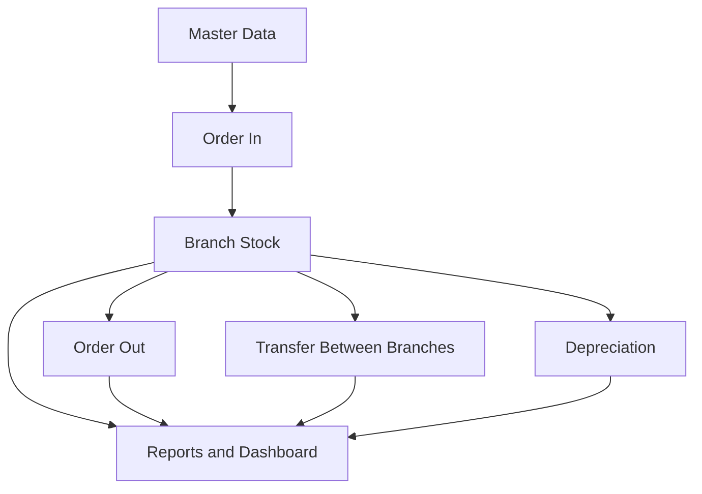

<div align="center">


# 📦 Inventory Management System
### نظام إدارة المخزون

**A bilingual, role-based inventory management application built with Oracle APEX and Oracle Database.**

**نظام لإدارة المخزون وحركاته وتقاريره، يدعم العربية والإنجليزية والصلاحيات حسب الدور.**


</div>

---

## ✨ Overview

Inventory Management System manages products and stock quantities across branches. Stock is updated through controlled inventory transactions, and users can monitor quantities, movement history, and discrepancies through reports and a dashboard.

> **Repository note:** This package contains an Oracle APEX application export and a bilingual user guide. Database schema deployment scripts and environment-specific configuration must be verified and supplied separately before a clean installation can be guaranteed.

## 🚀 Key Features

| Module | Capabilities |
|---|---|
| 🧾 Master Data | Branches, products, categories, units, suppliers, customers and employees |
| 📥 Order In | Receive products and increase branch stock |
| 📤 Order Out | Issue products and decrease branch stock, with stock validation |
| 🔁 Stock Transfer | Transfer quantities between branches |
| 📉 Depreciation | Record damaged/depreciated quantities and deduct stock |
| 📊 Dashboard | Stock KPIs, stock by branch, movement visualizations |
| 📋 Reports | Current stock, stock movements, reconciliation, transaction reports |
| 🔐 Authorization | Role-based access to administrative, stock and reporting functions |
| 🌍 Localization | Arabic RTL and English LTR interfaces |

## 🧭 How Stock Moves



- **Order In:** increases stock in the receiving branch.
- **Order Out:** decreases stock, provided sufficient quantity is available.
- **Transfer:** decreases stock at the source and increases it at the destination.
- **Depreciation:** decreases stock for the selected branch.
- **Reconciliation:** compares recorded stock against quantities calculated from supported transaction history; accuracy depends on complete opening balances and movement records.

## 🖥️ Application Screenshots

Add approved application screenshots under `assets/screenshots/` and update the paths below:

| Dashboard | Inventory Transactions |
|---|---|
| `assets/screenshots/dashboard.png` | `assets/screenshots/transactions.png` |

| Current Stock | Stock Movement |
|---|---|
| `assets/screenshots/current-stock.png` | `assets/screenshots/stock-movement.png` |

*Screenshots are intentionally not represented as uploaded until the final approved images are added.*

## 🔐 Roles & Permissions

The application uses authorization schemes to control access. Schemes used in the project include:

| Authorization scheme | Purpose |
|---|---|
| `IS_ADMIN` | Administrative/security access |
| `CAN_MANAGE_STOCK` | Inventory transaction management |
| `CAN_MANAGE_DEPRECIATION` | Depreciation management |
| `CAN_VIEW_REPORTS` | Reporting access |
| `CAN_VIEW_STOCK` | Stock visibility |
| `CAN_VIEW_MASTER_DATA` | Master data visibility |
| `CAN_MANAGE_MASTER_DATA` | Master data maintenance |
| `CAN_VIEW_TRANSACTIONS_MENU` | Inventory transaction menu visibility |

**Important:** Verify the role-to-scheme mappings and each page's authorization in the deployed application before using this table as a security audit.

## 🧰 Technology Stack

- Oracle APEX — application pages, interactive grids, reports and UI
- Oracle Database — relational inventory data
- SQL / PL/SQL — validations, procedures, triggers and business logic
- JavaScript / CSS — interface enhancements and bilingual presentation

## 📂 Repository Structure

```text
Inventory-Management-System/
├── README.md
├── .gitignore
├── apex/
│   └── oracle-apex-app-106-export.zip
├── assets/
│   ├── inventory-logo.png
│   └── screenshots/             # Add approved screenshots
└── docs/
    └── User_Guide_AR_EN.docx
```

## ⚙️ Installation & Setup

1. Prepare a compatible Oracle Database and Oracle APEX environment.
2. Create a dedicated database schema and required database objects using your **reviewed** DDL, PL/SQL, constraints and seed scripts. Do not use production credentials or unreviewed demo passwords.
3. Open **App Builder → Import** and import the application export (unzip it first if required by your APEX version/import workflow).
4. Confirm application ID, parsing schema, authentication, authorization and application static files.
5. Configure Arabic/English translations and confirm RTL/LTR display.
6. Test the stock procedures and triggers on a **non-production database** before allowing users to post transactions.
7. Run the acceptance checklist below.

> The included APEX export is not a substitute for a full database schema export. The Oracle APEX and database versions have not been independently verified for this package.

## ✅ Acceptance Checklist

- [ ] Authentication and role-based authorization verified
- [ ] Master data create/edit validations tested
- [ ] Order In updates stock correctly
- [ ] Order Out blocks insufficient stock
- [ ] Transfer adjusts both branches correctly
- [ ] Depreciation decreases stock correctly
- [ ] Update/delete transaction behavior verified
- [ ] Current Stock and Reconciliation totals checked
- [ ] Arabic and English views checked, including loading behavior
- [ ] No passwords, secrets or real personal data committed

## 📘 User Guide

📄 [Arabic & English User Guide (Word)](docs/User_Guide_AR_EN.docx)

## 🛡️ Security Notes

Never commit real database passwords, authentication secrets, wallet files, personal records, or sample accounts with working passwords. Review exported application configuration and SQL seed scripts before publishing this repository publicly. Use environment-specific configuration for deployment.

## 🗺️ Future Enhancements

- Approval workflow for stock transactions
- Exportable analytics and scheduled reporting
- Inventory audit trail improvements
- Automated deployment and regression tests

---

<div align="center">

**Inventory Management System — Built with Oracle APEX**

*Manage stock • Track movement • Improve visibility*

</div>
